<p align="center"></p>

<h1 align="center">vetcode</h1>

<p align="center"><b>Catch malicious packages, supply-chain attacks and leaked secrets before they reach your machine.</b><br>Zero dependencies. One command. Built for AI coding agents, works without one.</p>

<p align="center">
  <a href="https://github.com/openyard-cloud/vetcode/releases"></a>
  <a href="LICENSE"></a>
  
  <a href="bench/README.md"></a>
  <a href="https://openyard.cloud/p/vetcode#check"></a>
</p>

<p align="center"></p>

```bash
npx @openyard/vetcode .               # scan a project, a package or a cloned repo
npx skills add openyard-cloud/vetcode # or give it to your AI agent as a skill
```

- **More accurate than GuardDog on fresh malware samples.** On 1,000 npm packages it never saw: F1 96.1 vs 93.0, with a quarter of the false alarms (1.6% vs 6.4%). On PyPI the gap is wider: 88–89 vs 80, with 4% false alarms vs 20%.
- **Hard to fool.** It still catches 99–100% of the malware it caught after 8 kinds of disguise (split strings, hex escapes, character codes, reversed strings, base64 and gzip packing, code pushed off screen or into `dist/`). GuardDog loses up to 10%.
- **One run, everything.** Malware, supply chain, secrets, web and API bugs, cloud and server config, CI/CD, and AI agent setups (skills, MCP servers, `CLAUDE.md`), in 8 languages.
- **Reads, never runs.** Nothing from the target is installed, built or executed. Node 18+ and nothing else.

vetcode is an [Agent Skill](https://agentskills.io), an MCP server, a CLI, a GitHub Action and, in Claude Code, a [guard](#the-guard-checked-before-your-agent-installs) that checks packages before your agent installs them. A zero-dependency scanner finds candidates in seconds; then your agent (Claude, Codex, Gemini, Copilot, Cursor…) reads the code around each one, throws out false positives, and looks for what patterns cannot see (missing authorization, IDOR, broken business logic). You get a short report with real findings, attack scenarios and fixes.

Free and open source (MIT), from the [OpenYard](https://openyard.cloud) community.

## How it compares

Measured head to head: each tool scans exactly the same packages, drawn at random from public malware datasets, on samples that were never used to tune vetcode's rules. GuardDog is scored with each of its four verdicts (any issue, any threat rule, risk score ≥ 5, risk score ≥ 7) and credited with its best one.

**Malicious packages, vetcode vs [GuardDog](https://github.com/DataDog/guarddog)**

| | Samples | F1 | Precision | Recall | False alarms |
|---|---|---|---|---|---|
| **npm**, vetcode | 500 malicious + 499 clean | **96.1** | **98.3** | **94.0** | **1.6%** |
| npm, GuardDog | same | 93.0 | 93.5 | 92.4 | 6.4% |
| **PyPI**, vetcode | 300 malicious + 152 clean | **89.2** | **96.5** | **83.0** | **5.9%** |
| PyPI, GuardDog | same | 85.0 | 87.9 | 82.3 | 22.4% |

npm samples come from [NPMAnalysis](https://github.com/lxyeternal/NPMAnalysis), the dataset whose paper ranks GuardDog first among 13 detectors. PyPI malware comes from the [Datadog dataset](https://github.com/DataDog/malicious-software-packages-dataset); the clean side is popular packages from pypi.org. On PyPI vetcode has led on every fresh sample, mostly because it raises a quarter as many false alarms. On npm it is closer: vetcode led on most fresh samples, but GuardDog came out ahead on three smaller ones by up to 1.1 F1 points. The [full history](bench/README.md) lists every run, including those.

**Malicious agent skills, vetcode vs [Cisco skill-scanner](https://github.com/cisco-ai-defense/skill-scanner)**, both without an LLM, on 204 malicious skills (Datadog) and 132 clean ones (Anthropic, Trail of Bits, obra/superpowers):

| At severity high | Caught | False alarms |
|---|---|---|
| **vetcode** | **29.9%** | **3.0%** |
| Cisco skill-scanner | 23.5% | 15.9% |

Those numbers were measured before any rule was written from this dataset. Version 0.4.1 adds rules for what the misses had in common (a "required" tool to install from a throwaway host, an MCP or API endpoint on a tunnel, orders to act without confirmation) and catches **48.5%** of the same 204 with the same 3.0% false alarms. That figure is in-sample: the rules were written from descriptions of these samples, so it will be measured again on skills added to the dataset later.

Rules alone catch a minority of malicious skills for every tool; most of them are ordinary-looking instructions that need reading. That reading is the agent's step in vetcode's `SKILL.md` and is not part of these numbers.

**Also measured**

- **Disguised malware:** once samples are rewritten the way attackers dodge scanners (split strings, `\xNN` escapes, `String.fromCharCode`/`chr()` building, reversed strings, base64- or gzip-packed `eval`/`exec`, code pushed off screen or moved into `dist/`), vetcode still catches 99–100% of what it caught before; GuardDog drops to 90–92% on several of them (`bench/mutate.mjs`).
- **Speed:** on the same 30 PyPI packages (659 MB), GuardDog took 1,104 s and vetcode 299 s; vetcode has since become another third faster.
- **Techniques the datasets barely contain:** 15 of 15 caught from 2021–2026 campaigns, each next to a clean look-alike that is not flagged (`bench/redteam.mjs`): code pushed off-screen in `dist/`, GlassWorm Unicode payloads, payloads in images, protestware, time bombs, sandbox evasion, homoglyphs, disguised executables, recon beacons, ClawHavoc-style skills, a Visual Studio project that runs encoded PowerShell at build, a Rust build script that steals SSH keys, a Go module whose init() opens a shell.
- **Breadth:** one run covers malware, supply chain, secrets, web and API code, server and cloud configuration, CI/CD and AI agent setups. GuardDog covers malicious packages; Cisco skill-scanner covers skills.

**On real applications.** A scanner that cries wolf costs an agent tokens on every run, so false alarms are measured too: twelve well-known open-source apps (about 14,000 files, pinned to a commit) that handle tokens, passwords and API keys all day.

| Findings at medium or above | 0.3.1 | 0.4.0 |
|---|---|---|
| All twelve apps | 2,024 | **101** |
| Apps wrongly given a high or critical malware or supply-chain finding | 3 | **0** |

Detection on the malware benchmark is unchanged between the two versions. Run it yourself with `node bench/noise.mjs` (no model, no cost); details in [`bench/README.md`](bench/README.md#false-alarms-on-real-applications).

**Caveats.** Samples are 336 to 1,000 items, so numbers move by one or two points between samples. Most malicious packages in these datasets were found by GuardDog itself, which favours it. The numbers are the scanner alone; in normal use the agent re-reads every finding, which removes more false alarms. Everything is reproducible with the scripts in [`bench/`](bench/README.md).

## What it checks

| Area | Examples |
|---|---|
| **Malware** | decode-then-`eval`, download-and-run, reverse shells, credential and wallet theft (`~/.ssh`, `~/.aws`, browser profiles), env-var exfiltration to webhooks, `_0x` obfuscation, hidden Unicode payloads (GlassWorm), Trojan Source bidi characters, AI CLIs started with permission prompts off, self-spreading `npm publish` worms, `.pth` autoruns, miners, beacons that report host, user and IP, `.exe` droppers |
| **Supply chain** | install-time code that combines network access with secrets, programs or hidden code; dependency-confusion probes (install scripts that call home, version 99.x, self-deleting or detached scripts); suspicious `preinstall`/`postinstall`, typosquats (`expresss`, `@angullar/core`, `reqeusts`), git/URL dependencies, lockfile packages from foreign hosts, `--extra-index-url` dependency confusion, `setup.py` that runs code, VS Code tasks that run on folder open, git hooks, known vulnerable and **known malicious** packages via [OSV.dev](https://osv.dev) |
| **Build and install time, beyond npm and PyPI** | Rust `build.rs` and proc macros that download, run shells or read `~/.ssh`; `go:generate` lines that fetch and pipe to a shell, Go `init()` that starts programs or phones home, `go.mod` replace directives pointing at another repository; Ruby gem extensions (`extconf.rb`) that download; Composer scripts; MSBuild `Exec` tasks, pre/post-build events and inline tasks in `.csproj`/`.vcxproj`/`.targets`, NuGet `install.ps1`; Gradle builds that download and run shells, a Gradle wrapper pointing away from services.gradle.org, Maven exec/antrun plugins; package repositories over plain HTTP |
| **AI agents** | project `.claude/settings.json` with hooks, API base-URL redirects or auto-approved MCP servers; prompt injection and hidden comments in `CLAUDE.md`, `AGENTS.md`, `.cursorrules`, skills; poisoned MCP tool descriptions; unpinned or plain-HTTP MCP servers |
| **Secrets** | 40+ providers (cloud, AI, payment, SaaS, registries), private keys, database URLs, Supabase `service_role` keys (and not the public anon key), committed `.env`, secrets in git history, secrets behind `NEXT_PUBLIC_`/`VITE_` prefixes |
| **Web / API** (JavaScript/TypeScript, Python, PHP, Java/Kotlin, C#, Go, Ruby, Rust) | SQL/NoSQL/command injection, XSS, SSTI, path traversal, SSRF, open redirects, unsafe deserialisation, weak JWT handling, TLS checks off, permissive CORS, mass assignment, weak password hashing, insecure randomness, zip slip, XXE, prototype pollution, model output passed to `eval` |
| **Server & cloud** | root containers, secrets in image layers, privileged/socket-mounted containers, databases published on all interfaces, nginx alias traversal, public buckets, open SSH/RDP, Cloudflare secrets in `vars`, Supabase tables without RLS or with `using (true)` policies, Firebase rules open to everyone |
| **CI/CD** | `pull_request_target` / `workflow_run` running PR code, script injection from PR titles, `GITHUB_ENV` injection, `secrets: inherit`, persisted checkout credentials, self-hosted runners on public triggers, spoofable bot checks, once-compromised and tag-pinned actions, long-lived publish tokens instead of trusted publishing (and zizmor when installed) |
| **Hardening advice** | whether install scripts run for every dependency and brand-new releases install immediately, with the pnpm/npm/yarn/bun settings that fix it |

## Install

**One command, any agent that loads [Agent Skills](https://agentskills.io)** (Claude Code, Codex, Gemini CLI, GitHub Copilot, Cursor, Amp, Goose, opencode…):

```bash
npx skills add openyard-cloud/vetcode
```

**One command, Claude Code as a plugin** (run in your terminal):

```bash
claude plugin marketplace add openyard-cloud/vetcode && claude plugin install vetcode@openyard
```

Everything else (MCP, claude.ai, CI, a whole team) is below. All forms need Node.js 18+.

| Your agent | Use |
|---|---|
| Claude Code | the [plugin](#claude-code) or the [skill](#skill-any-agent-that-loads-agent-skills) |
| Codex, Gemini CLI, GitHub Copilot, Cursor, Amp, Goose, opencode, Windsurf, Cline, Roo… | the [skill](#skill-any-agent-that-loads-agent-skills) |
| Any agent or app that speaks MCP (Cursor, VS Code, Codex, Gemini CLI, Windsurf, Zed, Claude Desktop, ChatGPT…) | the [MCP server](#mcp-server) |
| claude.ai | the [skill zip](#claudeai) |
| CI, scripts, or no agent at all | the [CLI](#the-scanner-on-its-own) |

### Skill (any agent that loads Agent Skills)

The [skills CLI](https://vercel.com/docs/agent-resources/skills) knows where each agent looks for skills:

```bash
npx skills add openyard-cloud/vetcode
```

Or copy the folder yourself: `git clone https://github.com/openyard-cloud/vetcode`, then copy `vetcode/skills/vetcode` into your agent's skills folder: `.agents/skills/` (the shared location many agents read, e.g. Codex and Copilot), `.claude/skills/` (Claude Code), `.github/skills/` (Copilot), `.gemini/skills/` (Gemini CLI) or `.cursor/skills/` (Cursor), in the project or under your home folder.

### Claude Code

As a plugin, from inside a session it takes two commands, because Claude Code only installs from marketplaces it already knows. The first line is needed once per machine; without it the second says `Marketplace "openyard" not found`.

```
/plugin marketplace add openyard-cloud/vetcode
/plugin install vetcode@openyard
```

From the terminal the same is one line: `claude plugin marketplace add openyard-cloud/vetcode && claude plugin install vetcode@openyard`.

**For a whole team**, commit this to the project's `.claude/settings.json`. Everyone who opens the project and trusts the folder gets the OpenYard marketplace registered, so each person only runs `/plugin install vetcode@openyard` once:

```json
{
  "extraKnownMarketplaces": {
    "openyard": { "source": { "source": "github", "repo": "openyard-cloud/vetcode" } }
  },
  "enabledPlugins": { "vetcode@openyard": true }
}
```

### claude.ai

Download `vetcode-skill.zip` from [Releases](https://github.com/openyard-cloud/vetcode/releases) and upload it under Settings → Capabilities → Skills.

### MCP server

The server runs `npx` straight from this repository, pinned to a release. It offers three tools (`vetcode_scan`, `vetcode_guide`, `vetcode_reference`) and a `security_review` prompt.

Most agents (`.cursor/mcp.json`, `.mcp.json`, Claude Desktop, Gemini CLI `settings.json`, Windsurf `mcp_config.json`):

```json
{
  "mcpServers": {
    "vetcode": { "command": "npx", "args": ["-y", "-p", "github:openyard-cloud/vetcode#v0.5.0", "vetcode-mcp"] }
  }
}
```

VS Code (`.vscode/mcp.json`):

```json
{ "servers": { "vetcode": { "type": "stdio", "command": "npx", "args": ["-y", "-p", "github:openyard-cloud/vetcode#v0.5.0", "vetcode-mcp"] } } }
```

Codex (`~/.codex/config.toml`):

```toml
[mcp_servers.vetcode]
command = "npx"
args = ["-y", "-p", "github:openyard-cloud/vetcode#v0.5.0", "vetcode-mcp"]
```

Then ask your agent to "use vetcode to review this project". The agent should call `vetcode_guide` once; the server also tells it to.

### Agents that only read an instructions file

For tools that read `AGENTS.md` (or `.cursorrules`, `CONVENTIONS.md`…) but neither skills nor MCP, clone this repository next to your project and add:

```markdown
## The guard: checked before your agent installs

An agent decides to install a package in a second: a name it remembered wrong, a name a web page suggested, a release published an hour ago. Installing runs that package's code with your rights. With the Claude Code plugin, vetcode looks at every install command **before** it runs and answers allow, ask or deny:

| The command would… | Answer |
|---|---|
| install a package that does not exist (a made-up name is one an attacker can register) | deny |
| install a package with a malware advisory on [OSV.dev](https://osv.dev) | deny |
| install a package whose code looks malicious (the archive is downloaded and read, never run) | deny |
| install a name one letter from a popular package (`expres`, `reqeusts`) | ask |
| install a release less than 72 hours old, or one that lost its provenance or gained an install script | ask |
| pipe a download into a shell, or install from another index, a repository or a URL | ask |
| install well-known packages at settled versions | allow, silently |

It reads `npm`, `pnpm`, `yarn` and `bun` installs, `npx` and friends, `pip`, `uv`, `uvx`, `pipx` and `poetry`. Other shell commands cost one regex. "Ask" shows you the reason and waits for your answer; in a run with nobody to ask (`claude -p`) it stops the command and tells the agent why.

```bash
node skills/vetcode/scripts/guard.mjs "npm install expres"     # try it by hand
# ask (1 package checked)
# vetcode: expres looks like the popular package express. If express was meant, install that instead.
```

Agents without hooks can call the same check as the MCP tool `vetcode_guard`, or run the script above before installing.

**Settings** (environment variables): `VETCODE_GUARD=off` turns it off, `VETCODE_GUARD=strict` turns every ask into deny, `VETCODE_GUARD_MIN_AGE_HOURS=72` sets how old a release must be.

**What it sends:** the names and versions of the packages in the command, to the package registry (the one the install would contact anyway) and to OSV.dev, plus a download of the package archive, which is read and deleted. Packages that come from a private registry (a `registry=` line in `.npmrc`, `PIP_INDEX_URL` and the like) are not looked up anywhere. If the network is down or a check fails, the command is allowed: the guard never blocks on its own errors.

**Limits:** it checks the packages named in the command, not their dependencies and not a plain `npm install` from a lockfile (scan the project for that). It is not measured yet against an agent without it; that benchmark is next.

## Security reviews
When asked to check code for security problems or malware, follow `../vetcode/skills/vetcode/SKILL.md`
and run its scanner: `node ../vetcode/skills/vetcode/scripts/vet.mjs <folder>`.
```

## Use

Just ask:

- "Check this repo for malware before I run it"
- "Security review before I deploy"
- "Is this MCP server safe to install?"
- "Review my changes for security issues"

or run `/vetcode` in Claude Code (`/vetcode:vetcode` when installed as a plugin).

### The scanner on its own

```bash
npx @openyard/vetcode [path] [options]             # from npm (installed, the command is `vetcode`)
node skills/vetcode/scripts/vet.mjs [path] [options] # from a clone
```

| Option | |
|---|---|
| `--online` | look up dependencies on OSV.dev (known vulnerabilities and malware); also runs semgrep, osv-scanner and trivy if installed |
| `--deps` | read installed `node_modules`: install scripts, and the full code of packages that have them |
| `--history` | search git history for secrets that were committed and later removed |
| `--diff [base]` | only files changed against `base` (default: uncommitted changes) |
| `--no-ignore` | ignore `.vetcodeignore` and inline suppressions (always use this on code you did not write) |
| `--json file` / `--sarif file` | full results as JSON, or SARIF 2.1.0 for GitHub code scanning |
| `--baseline old.json` | show only findings that are not in an earlier `--json` report |
| `--mcp-lock file` | record the project's MCP servers and tool descriptions; later runs report anything that changed (rug pulls) |
| `--fail-on <severity>` | exit 1 if a finding at that level or worse exists |
| `--no-tools` | do not run external tools (gitleaks and zizmor run automatically if installed) |

### Pull request review on GitHub

vetcode can review every pull request: it scans only the files the pull request changes, comments on the exact lines it adds, lists what was already there, and fails the check only for problems on changed lines.

```yaml
# .github/workflows/vetcode.yml
name: vetcode
on: pull_request
permissions:
  contents: read
  pull-requests: write    # inline review comments
jobs:
  review:
    runs-on: ubuntu-latest
    steps:
      - uses: actions/checkout@v4
        with: { persist-credentials: false }
      - uses: openyard-cloud/vetcode@main   # pin a release tag or commit SHA
        with:
          fail-on: high        # critical, high, medium, low, or empty to never fail
```

Comments are not repeated on later pushes, and once a finding is gone (fixed or removed) its thread is resolved automatically. Pull requests from forks get a read-only token, so for them the results go to the job summary; their `vetcode-ignore` comments are also ignored, so a contributor cannot hide what they add. Inputs: `path`, `fail-on`, `comment`, `sarif`, `online`, `github-token`.

The review comments already annotate the pull request, so do not also upload the SARIF file from the same pull request run: GitHub code scanning would show every finding a second time. For the Security tab, upload it from pushes to your default branch instead (see Other CI below). These comments come from the scanner alone, with no AI: patterns, so a benchmark file that builds malware-shaped strings on purpose gets flagged like real malware. The agent step below reads each finding in context and drops the ones it cannot justify.

**With an AI agent.** The action is the scanner on its own. To have an agent confirm each finding and look for what patterns cannot see (authorization, business logic), run your agent in the same workflow and point it at the skill, for example with [Claude Code Action](https://github.com/anthropics/claude-code-action):

```yaml
      - uses: actions/checkout@v4
        with: { repository: openyard-cloud/vetcode, path: .vetcode, persist-credentials: false }
      - uses: anthropics/claude-code-action@v1
        with:
          anthropic_api_key: ${{ secrets.ANTHROPIC_API_KEY }}
          prompt: |
            Review this pull request for security problems. Follow .vetcode/skills/vetcode/SKILL.md
            and run its scanner with --diff origin/${{ github.base_ref }}. Comment only on confirmed findings.
```

### Other CI

Any CI that has Node.js 18+ can run the scanner and fail the build:

```bash
git clone --depth 1 https://github.com/openyard-cloud/vetcode .vetcode
node .vetcode/skills/vetcode/scripts/vet.mjs . --sarif vetcode.sarif --fail-on high
```

On GitHub, a push to the default branch can feed the Security tab with the same SARIF file: run the line above, then `github/codeql-action/upload-sarif@v3` with `sarif_file: vetcode.sarif` (needs `security-events: write`).

### Suppressing a false positive

```js
const id = Math.random(); // vetcode-ignore[insecure-random] used for a UI animation, not a secret
```

Name the rule. Folders can go in `.vetcodeignore` (gitignore syntax). Every report shows how much was suppressed, and `--no-ignore` turns all of it off.

## How it works, and its limits

The scanner is regex and heuristics: fast, offline and explainable. It produces candidates, not verdicts. The skill tells the agent to confirm each one with a concrete exploit scenario, drop what it cannot justify, and review what patterns cannot see. [Cisco's measurements on malicious agent skills](https://github.com/cisco-ai-defense/skill-scanner) found that rules alone catch a small share of them, while adding a model's judgement catches far more; vetcode is built around that combination.

It is not a guarantee. New malware, logic bugs and infrastructure outside the repository can still slip through. Treat a clean report as "nothing obvious found".

**What vetcode adds, and what it does not.** We measured the review step on 49 real authorization and business-logic advisories published after the model's training cutoff. Claude Code with vetcode found the bug in 41% of them, and on a 15-case control Claude Code alone did as well (7 against 8). Finding logic bugs is your agent's own ability; the skill does not raise it. What vetcode gives an agent is what it does not have by itself: every file read, not a sample; patterns for malware, supply-chain tricks and leaked secrets with measured accuracy; registry and advisory data newer than the model; and a procedure for looking at untrusted code without running it. The numbers and their limits are in [`bench/README.md`](bench/README.md#the-agent-step-on-real-advisories).

**Privacy:** the scanner runs locally and sends no code anywhere. The guard, when the plugin's hook is on, sends the package names in an install command to the registry and OSV.dev ([details](#the-guard-checked-before-your-agent-installs)). The scanner itself reaches the network only with `--online`: package names and versions go to OSV.dev, and installed semgrep, osv-scanner and trivy run with their own network access (semgrep downloads its rules). Secrets are redacted in every report. The review step is different: your agent reads the code, so that code goes to whichever model provider the agent uses (Anthropic, OpenAI, Google…), under that provider's terms. For code that must not leave the machine, run the scanner alone, or use an agent backed by a local model.

**What runs when.** Built in, always: every check listed above, including secrets, containers and infrastructure files. Automatically when installed: gitleaks and zizmor (`--no-tools` turns them off). Only with `--online`: OSV.dev, semgrep, osv-scanner and trivy.

## Learning from others

vetcode borrows ideas (not code) from projects that do parts of this very well, and works alongside them: [GuardDog](https://github.com/DataDog/guarddog), [zizmor](https://github.com/zizmorcore/zizmor), [gitleaks](https://github.com/gitleaks/gitleaks), [trufflehog](https://github.com/trufflesecurity/trufflehog), [Snyk agent-scan (mcp-scan)](https://github.com/invariantlabs-ai/mcp-scan), [OpenSSF malicious-packages](https://github.com/ossf/malicious-packages), [semgrep](https://github.com/semgrep/semgrep), [claude-code-security-review](https://github.com/anthropics/claude-code-security-review) and [Trail of Bits' skills](https://github.com/trailofbits/skills). If you need deep coverage in one area, use them too; vetcode will pick up gitleaks, semgrep, osv-scanner and trivy when they are installed.

## Contributing

New rules, fewer false positives and real-world samples are all welcome. See [CONTRIBUTING.md](CONTRIBUTING.md). Found a way to make vetcode miss malware? Please report it privately: [SECURITY.md](SECURITY.md).
